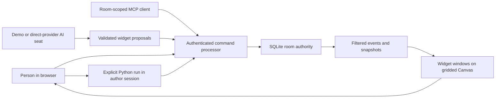

# Prototype implementation and contract review

The supplied `docs/CONTRACT.md` is preserved as Claude's draft. Timothy subsequently requested an actual working prototype. The code here implements the central shared-canvas path and records its boundaries rather than presenting every draft provision as complete.

## Architecture



Choose either Node SQLite or a Cloudflare SQLite Durable Object as the runtime. No dual-write replication is introduced. `src/storage.js` is the synchronous transaction seam; command hashing happens before the transaction, and broadcasts happen afterward.

## Code map

- `src/commands/`: authenticated transitions, receipt deduplication and version rules.
- `src/widgets/`: eight kind schemas and service-side cross-field validation. A `shape` kind is added; `drawing` remains stroke collections.
- `src/jobs/`: requester/session restrictions, lease operations and terminal retention.
- `src/events/`: event audiences, authorized snapshots and replay.
- `src/auth/`: expiring HMAC credentials; current membership checks.
- `src/providers/`: direct provider requests, native tool projection and normalization.
- `src/agents/`: one requested turn per seat, durable reservation, reply validation and command submission.
- `src/api.js`: common authenticated request handlers, invites and MCP tools.
- `src/local.js`: zero-install Node server with SQLite and SSE.
- `src/room/Room.js`, `src/worker.js`: Cloudflare bindings and WebSocket adapter.
- `public/`: Canvas interface and explicit-run Pyodide worker.

## Contract dispositions

- Identity is verified from a credential, never a seat ID. Owner/editor/member/viewer restrictions are enforced by the processor. Public seat IDs grant no access. AI seats are server-controlled.
- Python claims check requester AND credential session. This is stricter than requester-only identity, with the copied-credential limitation documented in README.
- Room and widget versions protect widget changes. Job lifecycle uses status and lease checks, exempt from unrelated room edits. Membership changes also bump room version.
- Events, replay and snapshots use the same audience policy. UI has the main chat and can display existing authorized side threads; side threads can be created through commands.
- Model calls occur outside transactions. The requester and seat are rechecked after the response, then each action goes through the common processor. Per-action acceptance is reported; a turn's multiple valid actions are not one atomic transaction.
- Native provider calls and a deterministic offline demo are implemented. Adapter tests use fixtures, not real accounts. Whisper, movement tools, automatic AI chains and a full provider capability/conformance matrix remain for integration with Claude's work.
- An account-wide budget remains required before subscriptions. Current room limits are prototype controls only. The operator gate is required before enabling paid providers. Unknown/failed usage reserves are charged conservatively to prototype allowance; these counters are not invoices.
- Hibernation socket attachments contain the verified principal and replay cursor, not raw credentials. Each message and broadcast revalidates membership. Idle credential expiry is checked on the next operation/broadcast; proactive idle socket expiry is not implemented.
- Command receipts use SHA-256 canonical intent excluding expected workspace version. Provider turn requests also use an idempotency key: a completed retry returns the result, an already-started/failed attempt cannot silently bill again. A stalled reservation expires; it does not promise exactly-once external computation.

## API examples

Create a room:

```http
POST /api/rooms
Content-Type: application/json

{"name":"Timothy","title":"Our little canvas"}
```

The returned room token is a credential; do not publish it. If the operator gate is configured, include `X-Room-Create-Key`.

All room reads/writes require `Authorization: Bearer <room-token>`, except invitation redemption and initial room creation.

```http
POST /api/rooms/<room>/commands
Content-Type: application/json
Authorization: Bearer <room-token>

{"contract":"gc/1","id":"unique-request-id","op":"widget.create","expectedVersion":0,"payload":{"id":"avatar-1","kind":"avatar","title":"My companion","layout":{"x":70,"y":70,"width":260,"height":280,"collapsed":false},"spec":{"glyph":"ג","name":"Little Gimel","mood":"Curious"}}}
```

Read `/snapshot` first to obtain the current version. Reuse a request ID only for the same intent; refreshed expectedVersion does not change the intent. Widget update/delete also require `payload.expectedWidgetVersion`.

`POST /turn` uses `{id,seat,prompt}`. MCP lives at `/mcp` and exposes `room_inspect`, `say`, and widget create/update/delete. This is an authenticated JSON request/response MCP prototype, not a verified Claude/ChatGPT OAuth connector. GraphQL is not bundled in this JavaScript port; the direct query and command interfaces already support the prototype, and the earlier Python GraphQL reference remains separate.
